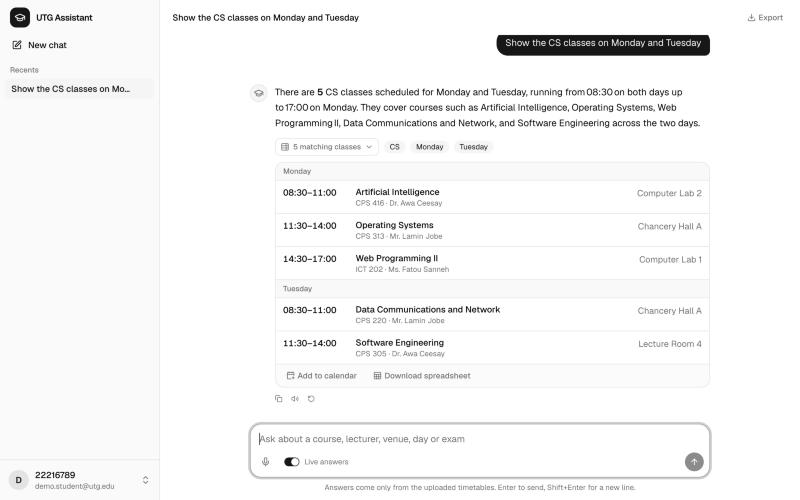
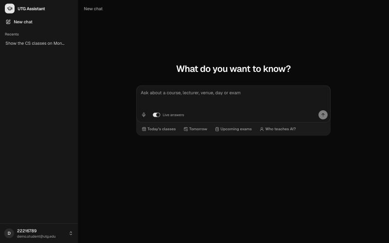
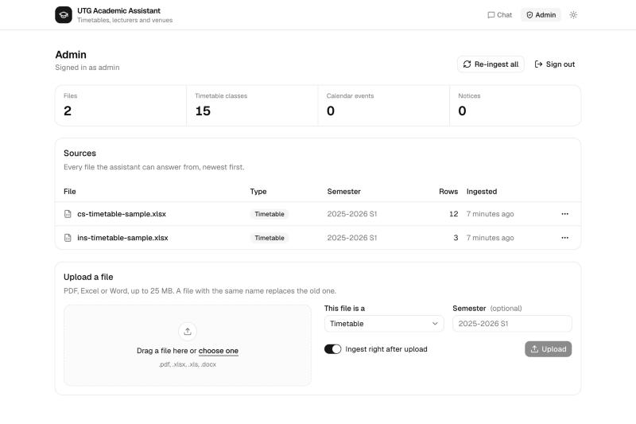
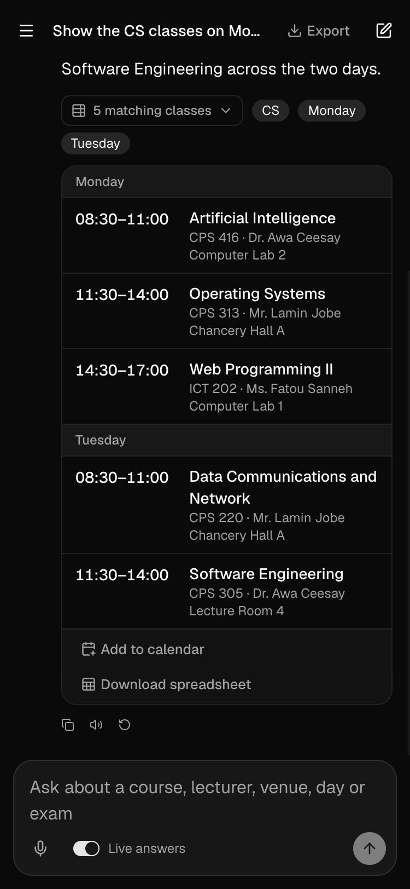

# **UTG Academic Assistant**

[](https://github.com/Baboucar/academic-assistant-ai/actions/workflows/web.yml)

The **UTG Academic Assistant** is a file-driven, locally controlled AI system designed for the University of The Gambia (UTG).
Students sign in and ask natural-language questions about:

* Class timetables: courses, lecturers, venues, times and departments
* Daily schedules, including "today", "tomorrow" and "my next class"
* **Exam timetables**: "When is the Operating Systems II exam?", "Which exams does Dr. Ceesay have?",
  "Show the upcoming exams"

They can type or speak the question, follow up ("What about Tuesday?"), and see the timetable rows each
answer was written from, laid out as a schedule that can be saved to a calendar or a spreadsheet.
When a question covers several departments, the assistant asks which one is meant.

What is in the box:

* A chat app with a sidebar of recent chats, voice input, read-aloud, light and dark themes, and export.
* Student accounts: matriculation number, university email and password, confirmed by an emailed code.
* An admin dashboard to upload class and exam timetables (PDF or Excel) and see what was read from them.

Answers are based on **local timetable files** (PDF/Excel/DOCX) that the system ingests into SQLite.
An **open model on Groq** (`openai/gpt-oss-120b` by default; set `MODEL` to change it) writes each answer and is instructed to answer only from the timetable database.

## **Screenshots**

The screenshots use made-up timetable data.

| Asking a question (light theme) | Starting a new chat (dark theme) |
| --- | --- |
|  |  |

| Admin dashboard | Mobile |
| --- | --- |
|  |  |

The admin screenshot was taken before the exam timetable type and the department field were added to the upload form.

--- | --- |
|  |  |

| Admin dashboard | Mobile |
| --- | --- |
|  |  |

---

## **Project Structure**

```text
academic-assistant-ai/
├── data/          # Your timetable files (PDF / Excel / DOCX); git-ignored
├── docs/          # Screenshots
├── ingest/        # Ingestion script + file parsers
├── server/        # Node.js API (Express + SQLite + Groq) and its tests
├── tmp/           # Auto-generated SQLite DB (utg.db)
└── web/           # Vue 3 + Vite + Tailwind + shadcn-vue chat and admin UI
```

---

## **Requirements**

* **Node.js 20.19+** (Vite 7 needs it)
* **Groq API key** (the free tier is enough)
* macOS or Linux recommended (Windows also works)

---

## **1. Installation & Setup**

From the project root:

### **Install dependencies**

```bash
npm --prefix ingest install
npm --prefix server install
npm --prefix web install
```

---

### **Create your `.env` file (inside `/server`)**

```bash
cp server/.env.example server/.env
```

Then open `server/.env` and set at least:

| Variable | What it is |
| --- | --- |
| `GROQ_API_KEY` | Your Groq key. Chat answers need it. |
| `ADMIN_USER`, `ADMIN_PASS` | Sign-in for the admin dashboard. Until both are set, `/api/admin/*` returns 503. |
| `SMTP_HOST`, `SMTP_PORT`, `SMTP_USER`, `SMTP_PASS`, `MAIL_FROM` | Email server for sign-up and password codes. Without `SMTP_HOST`, codes are printed in the server log. |
| `STUDENT_EMAIL_DOMAINS` | Email domains that may register, comma-separated. Defaults to `utg.edu`. |
| `MAT_NUMBER_PATTERN` | What a matriculation number looks like. Defaults to 5 to 12 letters or digits. |
| `CHAT_PER_MINUTE`, `CHAT_PER_DAY` | Questions each student may ask. Default 10 a minute and 150 a day. |
| `DEV_SHOW_CODES` | Local testing only: with no email server, show the code on the sign-up screen. Never set it on a real deployment. |
| `MODEL` | The model that writes answers. Defaults to `openai/gpt-oss-120b`. |
| `ORIGIN` | Who may call the API: `*`, or a comma-separated list such as `https://assistant.example.edu`. |
| `TIMEZONE` | Used for "today" and "tomorrow". Defaults to `Africa/Banjul`. |
| `TRUST_PROXY` | Set to `1` behind a reverse proxy so rate limits see real client addresses. |
| `GROQ_BASE_URL` | Optional. Any OpenAI-compatible endpoint, if you do not want Groq. |

---

### **Add timetable files**

Either upload them in the admin dashboard (step 5), or place PDF/Excel/DOCX files in `./data/`:

```
data/timetable.pdf
data/calendar.pdf
data/notices.docx
```

Excel class timetables need the columns `Course Code`, `Course Title`, `Day`, `Start`, `End`, `Room` and `Instructor`.

A file dropped into `data/` is read as an exam timetable if its name contains "exam", as the academic
calendar if it contains "calendar", and as a class timetable otherwise. Uploading in the dashboard lets
you choose the type, and a department or school code, yourself. See step 5 for the exam timetable layouts.

---

## **2. Build the SQLite database**

This reads everything under `data/` and generates `tmp/utg.db`:

```bash
node ingest/ingest.js
```

You should see output like:

```
Timetable PDF: timetable.pdf -> +89
Exam timetable PDF: exams.pdf -> +73
  note: Page 5: "Tuesday 8th December 2025 15:00 - 17:00" was read as 2026: that date is a Tuesday in 2026, not in 2025.
Ingestion complete -> tmp/utg.db
```

Lines starting with `note:` are things the reader corrected or could not place. Read them: they point at
typos in the file itself.

The server creates an empty database on first start, so this step can wait until you have files.

---

## **3. Run the API Server**

```bash
npm --prefix server run dev
```

Expected:

```
API on :5051
```

Health check (also reports whether the model key is set and how many rows are loaded):

```bash
curl http://localhost:5051/api/health
```

### Student accounts

Asking questions needs a signed-in student. Accounts use a matriculation number, a university email
address and a password, and the email is confirmed with a six-digit code.

| Endpoint | Body | Result |
| --- | --- | --- |
| POST `/api/auth/register` | `{ mat_number, email, password }` | Emails a code |
| POST `/api/auth/verify` | `{ email, code }` | `{ token, user }` |
| POST `/api/auth/resend` | `{ email }` | Emails a new code (at most one a minute) |
| POST `/api/auth/login` | `{ identifier, password }` (email or matriculation number) | `{ token, user }` |
| POST `/api/auth/forgot` | `{ email }` | Emails a password code |
| POST `/api/auth/reset` | `{ email, code, password }` | `{ token, user }`, and signs other devices out |
| GET `/api/auth/me`, POST `/api/auth/logout` | | Need the token |

Send the token as `Authorization: Bearer <token>` on `/api/chat` and `/api/tools/*`.
Passwords are stored as salted scrypt hashes; codes and session tokens are stored only as hashes.
A code works for 15 minutes and five tries; eight wrong passwords lock an account for 15 minutes.
The app cannot check that a matriculation number really belongs to the person registering.

Example chat query:

```bash
curl -sS -X POST http://localhost:5051/api/chat \
  -H 'Content-Type: application/json' \
  -H 'Authorization: Bearer <token>' \
  -d '{"question":"Who is teaching AI?"}'
```

The reply is `{ answer, matches, filters, slots, schedule, clarify? }`: the answer, the timetable rows
it was written from, and the search filters the question was turned into.

- `schedule` is true when there are three or more rows. The answer text then only summarises, and the
  client shows the rows as a schedule grouped by day (or by date for exams).
- `clarify` is present when a broad question ("What classes are on Monday?") matches more than one
  department. The answer asks "Which department do you want?" and `clarify.options` lists the choices.
  Sending one of them as the next question, with the earlier turns as `history`, re-asks the original
  question for that department.

### Exams

Questions that mention an exam ("When is the AI exam?", "Do I have an exam tomorrow?", "Show the
upcoming exams") are answered from the exam timetable. Exam rows have `"kind": "exam"` and a `date`.
Exams still to come are listed first.

### Follow-ups

Send the earlier turns as `history` so questions like "What about Tuesday?" can be resolved:

```json
{
  "question": "What about Tuesday?",
  "history": [
    { "role": "user", "text": "Show Monday schedule for CS" },
    { "role": "assistant", "text": "On Monday, CS has ..." }
  ]
}
```

### Streaming

Add `?stream=1` to receive Server-Sent Events, each a line of `data: {json}`:

| Event | When |
| --- | --- |
| `{ "event": "meta", "matches": [...], "filters": {...}, "slots": {...}, "schedule": bool, "clarify"?: {...} }` | Once, before the answer |
| `{ "event": "chunk", "text": "..." }` | As the model writes |
| `{ "event": "error", "message": "..." }` | If the model fails part-way |
| `{ "event": "done" }` | At the end |

### Limits

Questions are capped at 500 characters. Each student may ask 10 questions a minute and 150 a day
(`CHAT_PER_MINUTE`, `CHAT_PER_DAY`). Repeated failed admin sign-ins are also rate-limited.
When the model provider says it is busy, the server waits and retries for a few seconds before giving up.

---

## **4. Run the Front-End (Vue 3)**

```bash
npm --prefix web run dev
```

Then open:

```
http://localhost:5173
```

You can now ask questions like:

* **“Who teaches Intelligent Systems?”**
* **“Which courses is Baboucarr Drammeh teaching?”**
* **“How many courses is Jane Doe teaching on Monday?”**
* **“Show Monday schedule for CS.”** and then **“What about Tuesday?”**
* **“What classes are on tomorrow?”**
* **“When is the next class for ICT 202?”**

To point the UI at an API on another host, set `VITE_API_BASE` (for example in `web/.env.local`).

### Chat features
- **Live answers**: the answer appears as the model writes it. Turn the switch off to get it all at once.
- **Sign-in**: students create an account with their matriculation number and university email, confirmed by an emailed code.
- **Schedule view**: the classes or exams behind an answer are shown as a schedule grouped by day, with the filters that were searched. Longer results are shown open, with a short summary above.
- **Exams**: ask about an exam by course, date or day, or for the upcoming exams.
- **Which department?**: when a broad question covers several departments, the assistant asks which one, with buttons to pick.
- **Export**: download a chat as text, or print it / save it as a PDF. Download the classes or exams in an answer as a calendar file (`.ics`, classes repeat weekly for 15 weeks) or a spreadsheet (`.csv`).
- **Follow-ups**: recent turns are sent with each question.
- **Voice**: tap the mic and ask out loud. When you stop talking the question is sent, and the answer is read back. Tap the mic again to stop listening and edit the text first. Any answer can also be read aloud with its speaker button.
  Voice uses the browser's built-in speech support, so there is nothing to configure. Dictation works in Chrome, Edge and Safari; the mic is hidden in browsers without it (such as Firefox). Reading aloud works everywhere.
- **Copy, Edit, Try again, Stop**: per-message buttons; Edit and Try again apply to the latest exchange.
- **Recent chats**: each student's chats are saved in the browser (not on the server) and listed in the sidebar. A deleted chat can be undone straight away.
- **Keyboard**: Enter to send, Shift+Enter for a new line.
- **Theme**: light, dark or system, from the account menu at the bottom of the sidebar.

---

## **5. Admin Dashboard**

Open `http://localhost:5173/admin` and sign in with `ADMIN_USER` / `ADMIN_PASS` from `server/.env`.
The credentials are kept in memory only, so reloading the page signs you out.

You can:

- See every ingested file with its type, semester, row count and when it was last ingested.
  A file with 0 rows is flagged: nothing could be read from it.
- Upload a PDF, Excel or Word file (up to 25 MB) by drag-and-drop, and ingest it straight away.
- Upload an **exam timetable** as a PDF or an Excel file, choosing the type "Exam timetable".
  - **PDF**: the layout used by UTG schools is read: a dated heading such as "Tuesday 1st December 2026,
    9:00am - 11:00am" above a small table with the columns S/n, Code, Title, Lecturer, Venue, Invigilators
    and No. Students. Tables that continue over a page break are followed. The upload result lists
    anything the reader corrected (for example a heading whose year contradicts its weekday) or could
    not place, so check it after each upload.
  - **Excel**: needs a date column and a course code or title; time, venue, lecturer and department
    columns are picked up under their usual names ("Date", "Time" or "Start"/"End", "Course Code",
    "Course Title", "Venue"/"Hall"/"Room", "Lecturer").
- Give a class or exam timetable a **department or school** code (for example `CS` or `LAW`), so students
  can ask for one department.
- Re-ingest one file, or everything in `data/`.
- Remove a file from answers (database only), or delete the file as well. Both ask for confirmation.

Admin API endpoints (Basic Auth):

- GET `/api/admin/sources`
- POST `/api/admin/upload` (multipart form: `file`, `type` (`timetable`, `exams`, `calendar`, `notices`), `semester`, `dept`, `reingest`)
- DELETE `/api/admin/source/:file?deleteFile=0|1`
- POST `/api/admin/reingest` with JSON `{ file?: string, semester?: string }`

Upload and re-ingest wait for the ingest to finish and return its log, so the result you see is the real one.

---

## **6. Notes**

* The system is **fully file-based**:
  To update a semester, upload the new files in the admin dashboard, or replace files in `data/` and run:

  ```bash
  node ingest/ingest.js
  ```

* Answers are **grounded** in the SQLite database: the model gets only the matching rows
  and is instructed not to invent courses, times or lecturers.

* Only the question, the recent turns of the conversation and the matching timetable rows are sent to the model on Groq.
  The timetable files stay on the server, and everything in `data/` is git-ignored.

* **Capacity**: every question costs two model calls. A free Groq key allowed about 8,000 tokens a minute
  when this was measured, which is roughly 3 to 4 questions a minute for everyone together. That is fine
  for trying it out and far too little for a whole campus; plan for a paid tier or another provider
  (`GROQ_BASE_URL`, `MODEL`) before a wide launch.

* **What is stored**: student accounts (matriculation number, email, a password hash) and sign-in
  sessions are in the same SQLite file as the timetables, `tmp/utg.db`. Back that file up; deleting it
  deletes the accounts. Chats are kept only in each student's browser.

* **Before going live**: serve it over HTTPS, set `ORIGIN` to the site's address, configure `SMTP_*` so
  codes are emailed, and leave `DEV_SHOW_CODES` unset.

---

## **Tests**

```bash
npm --prefix web test      # Vitest + Vue Test Utils
npm --prefix server test   # node:test, against a throwaway database and a fake model
```

The web tests cover the streaming parser, chat state (sending, stopping, retrying, separate saved chats
per student), sign-in and sign-up screens, voice input and read-aloud, the chat and admin screens,
uploads, calendar/spreadsheet/text export, and escaping HTML in answers.
The server tests cover student accounts (codes, lockouts, password reset), question parsing, relative
days, follow-ups, exam questions, the "which department?" question, streaming, the admin routes
(including that file names cannot escape `data/`), a real ingest of uploaded spreadsheets, and the exam
PDF reader on hand-made page layouts that copy the quirks of a real timetable.
GitHub Actions runs both suites and a production build on every push.

Not covered by tests: answers from the real model, email delivery, and real timetable files (they are
not in the repository).

---

## **Future Improvements (Planned)**

### **1. Each student's own department and level**

Save them on the account, so "my classes tomorrow" needs no follow-up question.

### **2. Calendar and notices in chat**

Calendar and notice files are ingested, but chat answers only use the class and exam timetables so far.

### **3. Capacity**

Answer simple lookups without the model, and cache repeated questions, so the AI allowance goes further.

### **4. Admin accounts**

Separate sign-ins for admins, a record of who changed what, and a way to preview or correct the rows
read from a file before students see them.

### **5. More timetable layouts**

The class timetable PDF reader still struggles with messy rows (for example a lecturer's name inside the
course code cell). The exam PDF reader is built for the UTG school layout; other layouts will need work.

### **6. Advanced search**

* "Show conflicts for lecturer X"
* "Show free rooms on Thursday"
* "Which of my exams clash?"
